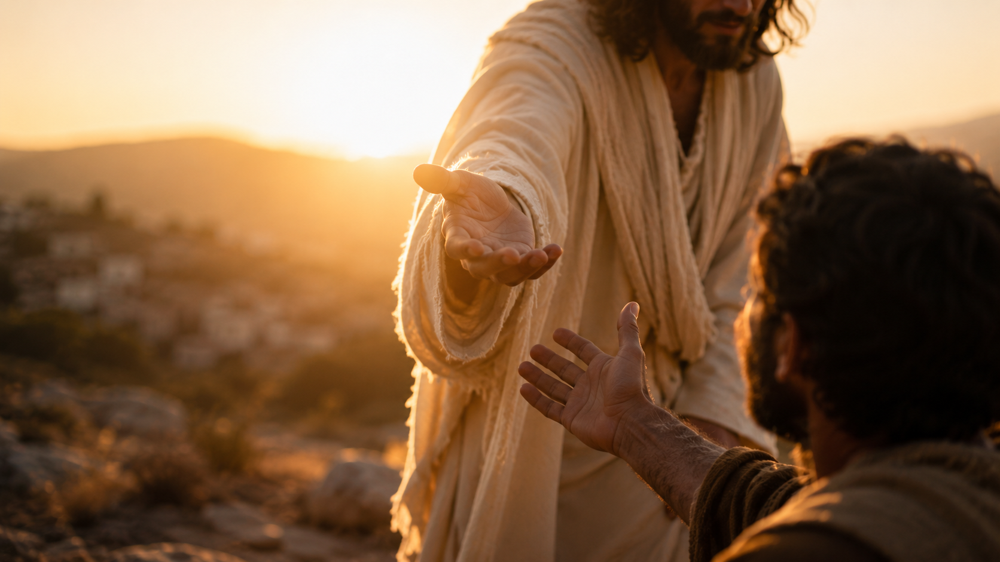

# PART I — THE GOSPEL

## CHAPTER 1

# SEEKING GOD

## Key Verse

> "But seek first the kingdom of God and his righteousness, and all these things will be added to you."
>
> — Matthew 6:33

---

# Before We Begin

Welcome to the beginning of an exciting journey.

Discipleship is much more than gaining biblical knowledge. It is learning to know Christ, follow Him, become more like Him, and help others do the same.

Throughout this course we will follow a simple rhythm:

> **Learn. Live. Share.**

Every lesson is designed to help us:

- Learn what God teaches through His Word.
- Live it out in our daily lives.
- Share it with someone else.

We encourage you not to wait until you have completed this course before helping someone else. Begin now. Pray for one person. Meet with that person regularly. Share what God is teaching you as you journey together.

Disciples make disciples.

Our journey begins with one simple but life-changing question:

> **What are you seeking?**

---

# Introduction

Every person is seeking something.

Some seek happiness.

Some seek success.

Some seek security.

Some seek wealth.

Some seek love.

Some seek acceptance.

Some seek purpose.

Some seek significance.

Whatever we pursue most reveals what our hearts value most.

The question is not whether we are seeking.

The question is **what** we are seeking.

Beneath every human pursuit lies a deeper longing that God Himself has placed within us.

The Bible teaches that we were created by God and for God. We were designed to know Him, worship Him, walk with Him, and enjoy fellowship with Him forever.

Yet because of sin, humanity exchanged the Creator for created things. Instead of seeking God, we often seek things that promise satisfaction but ultimately leave us empty.

More than sixteen centuries ago, Augustine wrote these famous words:

> "You have made us for Yourself, O Lord, and our hearts are restless until they rest in You."

His words remain just as true today.

Many people spend their lives climbing the ladder of success only to discover that it was leaning against the wrong wall.

Others pursue wealth, only to find that money cannot satisfy the deepest needs of the soul.

Still others seek relationships, recognition, achievement, or pleasure, hoping that these things will provide lasting fulfillment.

None of these pursuits can ultimately satisfy the human heart because they were never intended to replace God.

The good news of the gospel is not simply that we can seek God.

The good news is that **God has already been seeking us.**

Long before we ever thought about Him...

Long before we ever opened a Bible...

Long before we ever entered a church...

God was already at work.

He was arranging circumstances.

He was bringing people into our lives.

He was patiently drawing us toward Himself.

Every disciple's story begins there.

---

# 1. GOD SEEKS US FIRST

{ width=90% }

## Scripture

> "And he made from one man every nation of mankind to live on all the face of the earth, having determined allotted periods and the boundaries of their dwelling place, that they should seek God, and perhaps feel their way toward him and find him. Yet he is actually not far from each one of us."

> — Acts 17:26–27

When the Apostle Paul visited Athens, he found a city filled with temples, idols, and religious devotion.

The people were searching.

They worshipped many gods.

They built altars.

They offered sacrifices.

Yet they still did not know the one true God.

Standing before the philosophers at the Areopagus, Paul proclaimed something remarkable.

The God of the Bible is not distant.

He is not confined to temples.

He does not depend upon human beings.

He is the Creator of heaven and earth.

Then Paul makes an astonishing statement.

God determined **when** we would live.

God determined **where** we would live.

Why?

"So that they should seek God."

This means our lives are not accidents.

The family into which we were born...

The nation where we live...

The generation in which we were raised...

The opportunities we have received...

The people we have met...

Even many of our disappointments and hardships...

None of these are outside God's sovereign care.

Looking back over our lives, many of us can now recognize moments that once appeared to be coincidence but were actually God's providence.

Perhaps someone invited you to church.

Perhaps a friend shared the gospel.

Perhaps a crisis caused you to ask questions you had never considered before.

Perhaps God used a disappointment to expose the emptiness of pursuing other things.

What seemed random at the time was often God's loving hand drawing you toward Himself.

God is always at work long before we recognize His presence.

This truth is seen from the very beginning of Scripture.

The same truth is seen in the very first pages of the Bible.

After Adam and Eve sinned, they hid themselves among the trees of the garden.

Fear replaced fellowship.

Shame replaced innocence.

Instead of running toward God, they ran away from Him.

Who took the initiative?

Not Adam.

Not Eve.

God.

> "But the LORD God called to the man and said to him, 'Where are you?'"
>
> — Genesis 3:9

God's question was not asked because He had lost Adam.

God knew exactly where Adam was.

The question exposed Adam's spiritual condition rather than his physical location.

Throughout history, God has continued asking that same question.

"Where are you?"

Not merely,

"Where are you living?"

or

"Where are you working?"

but

"Where are you in your relationship with Me?"

From Genesis to Revelation, we discover a God who lovingly pursues people who have wandered away from Him.

This theme reaches its fullest expression in Jesus Christ.

{ width=90% }

Jesus described His mission with these words:

> "For the Son of Man came to seek and to save the lost."
>
> — Luke 19:10

Notice what Jesus did **not** say.

He did not say,

"The Son of Man came to welcome those who eventually found Him."

Nor did He say,

"The Son of Man came to reward those who searched hard enough."

Instead, He said,

"The Son of Man came to seek and to save the lost."

This is the heart of the gospel.

God does not wait passively for sinners to find Him.

He lovingly takes the initiative.

He pursues.

He calls.

He invites.

He rescues.

When we finally respond to Him, we discover that He has been working in our lives all along.

Recognizing this changes how we understand discipleship.

Discipleship does not begin with our decision to seek God.

It begins with God's gracious initiative toward us.

Our seeking is always a response to His seeking.

---

## Reflection Questions

1. Looking back over your life, where can you now recognize God's hand at work?

2. What people or circumstances has God used to draw you toward Himself?

3. How does knowing that God sought you first change your understanding of your own spiritual journey?

---

# 2. GOD REWARDS THOSE WHO SEEK HIM

## Scripture

> "You will seek me and find me, when you seek me with all your heart."
>
> — Jeremiah 29:13

If God seeks us first, does that mean we have no responsibility?

Not at all.

The Bible presents two complementary truths.

God takes the initiative.

We are called to respond.

Throughout Scripture, God invites people to seek Him.

This invitation is not extended reluctantly.

It flows from His love.

He desires to be known.

He desires to be found.

Jeremiah records one of the Bible's most beautiful promises:

> "You will seek me and find me, when you seek me with all your heart."

Notice the condition.

God is not speaking about casual curiosity.

He is speaking about wholehearted pursuit.

Many people treat God as one interest among many.

They seek Him only when life becomes difficult.

They pray only in times of crisis.

They attend church occasionally but never truly pursue a relationship with Him.

God desires something deeper.

He desires our hearts.

Seeking God means more than acquiring biblical knowledge.

It means pursuing a relationship with the One who created us.

Like every healthy relationship, it requires time.

It requires listening.

It requires trust.

It requires surrender.

The writer of Hebrews reinforces this same truth.

> "And without faith it is impossible to please Him, for whoever would draw near to God must believe that He exists and that He rewards those who seek Him."
>
> — Hebrews 11:6

This verse reminds us of two foundational realities.

First, we believe that God exists.

Second, we believe that He rewards those who sincerely seek Him.

Many people believe the first statement.

Far fewer truly believe the second.

Some imagine God to be distant.

Others think He is reluctant to receive them.

Still others fear they have wandered too far away.

The gospel tells a different story.

God delights in revealing Himself to those who genuinely seek Him.

He is not hiding from us.

He is inviting us.

The question is not whether God is willing to be found.

The question is whether we are willing to seek Him with all our hearts.

## Reflection Questions

1. What does it mean to seek God with all your heart?

2. What distractions most often compete for your attention?

3. What practical steps can you take to make seeking God a daily priority?

---

# 3. SEEK FIRST HIS KINGDOM

{ width=90% }

## Scripture

> "But seek first the kingdom of God and his righteousness, and all these things will be added to you."
>
> — Matthew 6:33

Perhaps no verse summarizes the Christian life better than this one.

Jesus spoke these words during the Sermon on the Mount after addressing many of the concerns that occupy our daily lives.

Food.

Clothing.

Finances.

Security.

The future.

These are all legitimate concerns.

Jesus did not dismiss them.

Neither did He suggest that His followers should become careless or irresponsible.

Instead, He challenged their priorities.

Notice that Jesus did not say,

"Do not seek."

Seeking is part of human nature.

Everyone seeks something.

The real question is:

**What comes first?**

Many people organize their lives around career, success, comfort, financial security, reputation, or personal achievement.

None of these things are necessarily wrong.

Work is good.

Money is useful.

Family is important.

Planning for the future is wise.

The problem begins when good things become ultimate things.

Whenever anything takes God's rightful place, it becomes an idol.

Jesus calls His disciples to a different way of living.

Seek first God's Kingdom.

To seek God's Kingdom means that His rule, His will, and His purposes become the highest priority in every area of life.

It means asking questions like:

- What pleases God?
- How can I glorify Him in my work?
- How can I serve others?
- How can I reflect Christ in my relationships?
- How can I use my resources for His Kingdom?

Seeking God's Kingdom first does not mean life suddenly becomes easy.

Christians still face illness.

They still experience disappointment.

They still encounter financial pressures and uncertainty.

The difference is that our confidence no longer rests in our circumstances.

Our confidence rests in God.

When He becomes our highest priority, everything else begins to find its proper place.

Instead of allowing our circumstances to define our peace, we allow God's promises to shape our perspective.

This is why Jesus concludes with the promise:

> "...and all these things will be added to you."

Jesus is not promising wealth or a life without problems.

He is assuring us that our heavenly Father knows what we need and is faithful to care for His children.

Seeking God first is therefore not simply a command.

It is an invitation to trust the One who already knows, loves, and provides for us.

---

## Reflection Questions

1. What currently receives the greatest share of your time, energy, and attention?

2. What practical changes would help you seek God's Kingdom first each day?

3. How does trusting God change the way you think about your future?

---

# 4. ONE HEART, ONE THRONE

{ width=90% }

## Scripture

> "No one can serve two masters, for either he will hate the one and love the other, or he will be devoted to the one and despise the other. You cannot serve God and money."
>
> — Matthew 6:24

Immediately before telling His followers to seek first God's Kingdom, Jesus addressed one of the greatest competitors for the human heart.

Money.

Money itself is not evil.

Scripture never teaches that possessing wealth is sinful.

In fact, money can be used to provide for our families, support ministry, help those in need, and advance God's Kingdom.

The problem is not money.

The problem is mastery.

Jesus says,

"No one can serve two masters."

A servant cannot divide his ultimate loyalty.

Sooner or later, one master will take first place.

Money promises many things.

It promises security.

It promises comfort.

It promises independence.

It promises control.

For this reason, people are often tempted to trust wealth more than they trust God.

Jesus exposes the deeper issue.

The battle is not between God and money.

The battle is for the human heart.

Every heart has a throne.

Only one King can sit upon it.

If God sits upon the throne, money becomes a servant.

If money sits upon the throne, it becomes a master.

The question is not simply,

"How much money do I have?"

The better question is,

"Who rules my heart?"

Seeking God first means placing Him on the throne of our lives.

Every decision...

Every ambition...

Every relationship...

Every possession...

is brought under His lordship.

This is what it means to follow Christ.

He is not merely an important part of our lives.

He is Lord over every part of our lives.

---

## Reflection Questions

1. What competes most strongly for first place in your heart?

2. In what ways can money become a master rather than a servant?

3. What would seeking God first look like in your work, family, finances, and daily decisions?

---

# Chapter Summary

Every person is seeking something.

Some seek success.

Some seek security.

Some seek wealth.

Some seek recognition.

Some seek happiness.

Yet beneath every human pursuit lies a deeper longing that only God can satisfy.

The Bible reveals an amazing truth:

Before we ever sought God,

**God was already seeking us.**

He has been working throughout history, arranging people, places, relationships, and circumstances so that we might come to know Him.

Our response is to seek Him with all our hearts.

Jesus calls us to place God's Kingdom above every other pursuit.

This does not mean ignoring the responsibilities of daily life.

Rather, it means allowing every part of our lives to come under God's rule.

Every heart has a throne.

Only one King can sit upon it.

When Christ is on the throne, everything else begins to find its proper place.

Seeking God is not merely the first lesson of discipleship.

It is the foundation upon which every other lesson is built.

---

# Memory Verse

> "But seek first the kingdom of God and his righteousness, and all these things will be added to you."
>
> — Matthew 6:33

---

# Disciple-Making Challenge

{ width=90% }

Discipleship is never intended to stop with us.

As God teaches us, we are called to help others follow Christ as well.

During the coming fortnight, prayerfully commit yourself to these simple steps.

1. Read **Matthew 6** several times.

2.  Spend at least **15 minutes each day** seeking God in prayer and through His Word.

3.  Memorize **Matthew 6:33**.

4.  Ask God to place **one person** on your heart.

5.  Pray for that person every day.

6.  Meet with that person before our next lesson.

7.  Share one thing God has been teaching you from this chapter.

You do not need to be an expert before you begin investing in someone else.

Simply share what you are learning as you continue following Christ together.

That is how disciples make disciples.

---

# Personal Commitment

Having completed this chapter, I desire to make seeking God the highest priority in my life.

With God's help, I also commit myself to intentionally investing in one other person throughout this discipleship journey.

Name of the person I will pray for and encourage:

___________________________________________

Signature:

___________________________________________

Date:

___________________________________________

---

# Prayer

Heavenly Father,

Thank You for loving me long before I ever thought about seeking You.

Thank You for patiently working through people, circumstances, and experiences to draw me to Yourself.

Forgive me for the times I have allowed other things to take first place in my life.

Teach me to seek Your Kingdom above everything else.

Help me to trust You more than my own plans, my possessions, or my fears.

Rule over every part of my life and shape my heart to become more like Jesus.

I also pray for the one person You are placing on my heart.

Give me the courage to pray for them, to love them, and to share with them what You are teaching me.

May my life become a faithful reflection of Your grace so that others may come to know You as well.

In Jesus' name,

**Amen.**
